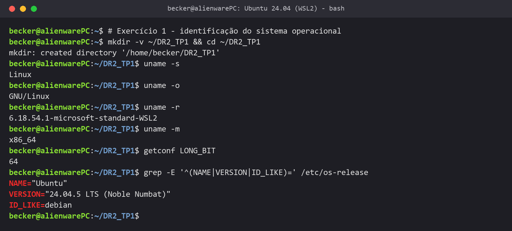

<div align="center">


# 🐧 O Terminal Linux na Prática

**Identificação do sistema, comandos básicos, navegação, manipulação de arquivos, documentação, pipelines, expansões e aspas no bash do Ubuntu**

<sub>DR2-TP1 · Bloco Ciência da Computação · Trabalho individual</sub>

<br/>

[](docs/RELATORIO_TP1.md)
[](evidencias/DR2_TP1)

<br/>

[](#ambiente)
[](#ambiente)
[](#ambiente)
[](#como-reproduzir)
[](LICENSE)
[](#estado)

<br/>



<sub>Identificação do sistema operacional no terminal do Ubuntu (Exercício 1).</sub>

</div>

---

<a id="indice"></a>

## 📚 Índice

| | O trabalho | | Qualidade e entrega |
|:---:|---|:---:|---|
| 01 | [Visão geral](#visao-geral) | 05 | [Atendimento à rubrica](#atendimento) |
| 02 | [Os 12 exercícios](#exercicios) | 06 | [Estrutura do projeto](#estrutura) |
| 03 | [Ambiente](#ambiente) | 07 | [Estado do projeto](#estado) |
| 04 | [Como reproduzir](#como-reproduzir) | 08 | [Referências](#referencias) |
| | | 09 | [Licença](#licenca) |

---

<a id="visao-geral"></a>

## 💡 Visão geral

Teste de Performance com 12 exercícios sobre o uso do Linux pela linha de comando. Fiz todos no
terminal do Ubuntu, no WSL2, e cada exercício gera o arquivo de evidência (`.txt`) pedido pelo
enunciado:

- **o sistema:** o papel do Linux, a distribuição instalada e os recursos de CPU, memória e disco;
- **o terminal:** comandos básicos, navegação, visualização e manipulação de arquivos;
- **a documentação do próprio sistema:** `type`, `which`, `help`, `man`, `apropos`, `info`, `whatis` e `alias`;
- **o shell:** pipelines, redirecionamento, expansões e aspas.

Os prints foram copiados do próprio terminal no momento em que cada comando terminou, sem recorte
nem edição, inclusive as telas do `less`, do `man` e do `info`. Todos os `.txt` seguem o mesmo
padrão: cabeçalho, registro literal da sessão e observações com as justificativas.

<p align="right"><a href="#indice">⬆ voltar ao índice</a></p>

---

<a id="exercicios"></a>

## 🧭 Os 12 exercícios

| Ex. | Tema | Comandos principais | Evidência | Detalhes |
|:---:|---|---|---|:---:|
| 1 | Papel do Linux | `uname`, `getconf`, `/etc/os-release` | [sistema_linux.txt](evidencias/DR2_TP1/sistema_linux.txt) | [ver](docs/RELATORIO_TP1.md#exercicio-1) |
| 2 | Distribuições | `lsb_release`, `/etc/os-release`, `/etc/issue` | [distribuicoes.txt](evidencias/DR2_TP1/distribuicoes.txt) | [ver](docs/RELATORIO_TP1.md#exercicio-2) |
| 3 | Comandos básicos | `date`, `cal`, `df`, `free`, `exit` | [comandos_basicos.txt](evidencias/DR2_TP1/comandos_basicos.txt) | [ver](docs/RELATORIO_TP1.md#exercicio-3) |
| 4 | Recursos | `lscpu`, `nproc`, `free`, `df`, `lsblk` | [recursos.txt](evidencias/DR2_TP1/recursos.txt) | [ver](docs/RELATORIO_TP1.md#exercicio-4) |
| 5 | Navegação | `pwd`, `cd`, `ls` | [navegacao.txt](evidencias/DR2_TP1/navegacao.txt) | [ver](docs/RELATORIO_TP1.md#exercicio-5) |
| 6 | Visualização | `ls`, `file`, `less` | [visualizacao.txt](evidencias/DR2_TP1/visualizacao.txt) | [ver](docs/RELATORIO_TP1.md#exercicio-6) |
| 7 | Manipulação | `mkdir`, `cp`, `rm -i` | [manipulacao.txt](evidencias/DR2_TP1/manipulacao.txt) | [ver](docs/RELATORIO_TP1.md#exercicio-7) |
| 8 | Documentação | `type`, `which`, `help`, `man`, `apropos`, `info`, `whatis`, `alias` | [comandos_auxiliares.txt](evidencias/DR2_TP1/comandos_auxiliares.txt) | [ver](docs/RELATORIO_TP1.md#exercicio-8) |
| 9 | Pipeline | `\|`, `>`, `less`, `wc` | [pipeline.txt](evidencias/DR2_TP1/pipeline.txt) | [ver](docs/RELATORIO_TP1.md#exercicio-9) |
| 10 | Expansões | `*`, `[ ]`, `{a,b}`, `{01..03}` | [expansoes.txt](evidencias/DR2_TP1/expansoes.txt) | [ver](docs/RELATORIO_TP1.md#exercicio-10) |
| 11 | Aspas | `" "`, `' '`, `\` | [aspas.txt](evidencias/DR2_TP1/aspas.txt) | [ver](docs/RELATORIO_TP1.md#exercicio-11) |
| 12 | Projeto final | `mkdir`, `ls`, `file`, `less`, `whatis`, `type` | [projeto_final.txt](evidencias/DR2_TP1/projeto_final.txt) | [ver](docs/RELATORIO_TP1.md#exercicio-12) |

Cada exercício no [relatório técnico](docs/RELATORIO_TP1.md) traz o enunciado, a teoria, os prints
do terminal e a minha resposta.

<p align="right"><a href="#indice">⬆ voltar ao índice</a></p>

---

<a id="ambiente"></a>

## 🖥️ Ambiente

| Item | Configuração |
|---|---|
| Sistema hospedeiro | Windows 11 Pro |
| Linux | Ubuntu 24.04.5 LTS (Noble Numbat) no WSL2 |
| Kernel | 6.18.54.1-microsoft-standard-WSL2, x86_64 (64 bits) |
| Shell | GNU bash 5.2.21 |
| VM do WSL | 10 CPUs lógicas (Intel Core i9-12900H), 16 GB de RAM, disco ext4 de 1 TB |
| Diretório de trabalho | `~/DR2_TP1`, copiado em [evidencias/DR2_TP1](evidencias/DR2_TP1) |

O meu shell de login no WSL é o fish, mas usei o bash, que é o shell padrão do Ubuntu e da
disciplina. O `help`, o `type` e a sintaxe de `alias` do Exercício 8 são do bash.

<p align="right"><a href="#indice">⬆ voltar ao índice</a></p>

---

<a id="como-reproduzir"></a>

## ▶️ Como reproduzir

Os exercícios rodam num bash dentro de um tmux com configuração própria, isolada do `~/.tmux.conf`.
Cada comando é digitado no terminal e executado de verdade, e cada tela é extraída do buffer do
terminal (`tmux capture-pane`).

```bash
wsl -d Ubuntu --exec bash scripts/capturar_telas.sh
```

O roteiro recomeça do zero:

- apaga `~/DR2_TP1`;
- remove o pacote `ncal`, porque o Exercício 3 mostra a falta do `cal` e a instalação;
- tira o alias `lsl` do `~/.bash_aliases`, que o Exercício 8 grava de novo.

Para converter as telas em PNG:

```bash
uv run --no-project --with pillow python scripts/renderizar_telas.py
```

O documento de entrega é montado sobre o molde institucional e exportado pelo Word:

```bash
python scripts/gerar-documento.py
```

```bash
powershell -ExecutionPolicy Bypass -File scripts/exportar-pdf.ps1
```

<p align="right"><a href="#indice">⬆ voltar ao índice</a></p>

---

<a id="atendimento"></a>

## 🎯 Atendimento à rubrica

| Critério | Onde está |
|---|---|
| Justifica a importância do Linux em sistemas computacionais modernos | Ex. 1 (papel do Linux) e Ex. 2 (distribuições e contextos de uso) |
| Opera o terminal executando comandos básicos corretamente | Ex. 1 a 4: `uname`, `getconf`, `lsb_release`, `date`, `cal`, `df`, `free`, `exit`, `lscpu`, `lsblk` |
| Navega pelo sistema de arquivos pela linha de comando | Ex. 5 (`cd`, `pwd`, caminho absoluto, `~`) e o `cd` nos Ex. 6, 7, 11 e 12 |
| Visualiza e manipula arquivos e diretórios com precisão | Ex. 6 (`ls`, `file`, `less`), 7 (`mkdir`, `cp`, `rm -i`), 9 (pipeline e `>`), 10 (expansões), 11 (aspas) e 12 |
| Usa comandos auxiliares para documentação e suporte | Ex. 8 (`type`, `which`, `help`, `man`, `apropos`, `info`, `whatis`, `alias`) e Ex. 12 |
| Justifica decisões técnicas | Apresentação do relatório, resposta de cada exercício e observações de cada `.txt` |
| Organiza e documenta os artefatos produzidos | `~/DR2_TP1` com um `.txt` por exercício, no mesmo padrão, e a tela da organização final |

<p align="right"><a href="#indice">⬆ voltar ao índice</a></p>

---

<a id="estrutura"></a>

## 📁 Estrutura do projeto

```
linux_tp1/
├── LICENSE                  licença de código visível, com o aviso LGPD
├── docs/
│   ├── RELATORIO_TP1.md     relatório técnico, com os prints
│   ├── context/             enunciado e rubrica
│   └── molde/               modelo do documento de entrega
├── evidencias/
│   ├── telas/               prints do terminal (23)
│   └── DR2_TP1/             cópia de ~/DR2_TP1: os 12 .txt e os diretórios dos exercícios
└── scripts/
    ├── capturar_telas.sh    executa os exercícios no tmux e grava telas e .txt
    ├── renderizar_telas.py  telas do tmux → PNG
    ├── gerar-documento.py   relatório → documento de entrega (.docx)
    ├── exportar-pdf.ps1     .docx → PDF pelo Word
    ├── tmux_tp1.conf        configuração isolada do tmux
    └── bashrc_tp1           bash das capturas (carrega o ~/.bashrc)
```

<p align="right"><a href="#indice">⬆ voltar ao índice</a></p>

---

<a id="estado"></a>

## 📌 Estado do projeto

Os 12 exercícios estão executados e documentados, com as 23 telas e os 12 arquivos de evidência.
O documento de entrega (`andre_becker_DR2_TP1.pdf`, com os prints e os `.txt` no anexo) vai pela
plataforma do Infnet e não é versionado aqui.

<p align="right"><a href="#indice">⬆ voltar ao índice</a></p>

---

<a id="referencias"></a>

## 📖 Referências

- SHOTTS, W. *The Linux Command Line*. 2. ed. San Francisco: No Starch Press, 2019. Caps. 1 a 7.
- TANENBAUM, A. S.; BOS, H. *Sistemas Operacionais Modernos*. 4. ed. São Paulo: Pearson, 2016. Cap. 1.
- Páginas de manual do Ubuntu 24.04: `uname(1)`, `os-release(5)`, `df(1)`, `free(1)`, `file(1)`, `less(1)`, `rm(1)` e `bash(1)`.
- FREE SOFTWARE FOUNDATION. *GNU Coreutils Manual* e *GNU Bash Reference Manual*.
- THE LINUX FOUNDATION. *Filesystem Hierarchy Standard*, versão 3.0, 2015.

<p align="right"><a href="#indice">⬆ voltar ao índice</a></p>

---

<a id="licenca"></a>

## 📜 Licença

Copyright © 2026 André Luis Becker. Todos os direitos reservados, sobre a contribuição original
deste trabalho.

Este repositório é **de código visível (source-available), não de código aberto**. É público para
ser lido, estudado e avaliado, e o corpo docente da instituição avaliadora pode executá-lo
livremente para conferir a entrega. Qualquer outro uso, incluindo clonar, executar, modificar ou
redistribuir, depende de autorização escrita. Os termos completos estão em [LICENSE](LICENSE).
