# O Terminal Linux na Prática

> **DR2-TP1 · Bloco Ciência da Computação**\
> Disciplina: Sistemas Operacionais com Linux e Python\
> Trimestre: 26E4_2\
> Professor: Leonardo Silva da Gloria\
> Aluno: André Luis Becker\
> Sala: GRLENGR2C2-N2-L1\
> Repositório: [andrebecker84/dr2-tp1-terminal-linux](https://github.com/andrebecker84/dr2-tp1-terminal-linux)

<!--
Fonte do documento de entrega (scripts/gerar-documento.py). O que fica entre "so-github" e
"/so-github" e as seções "### Enunciado" aparecem só aqui, no GitHub. Em cada comentário
"arquivo: X" do anexo, o gerador insere no PDF o conteúdo integral de evidencias/DR2_TP1/X.
-->

<!-- so-github -->
> Relatório técnico completo. Cobre os 12 exercícios do [enunciado](context/enunciado-DR2-TP1.md) e
> os 7 critérios da [rubrica](context/rubrica-DR2-TP1.md). Cada exercício traz o enunciado, a teoria,
> os prints do terminal e a minha resposta. Os arquivos de evidência (`.txt`) estão em
> [evidencias/DR2_TP1](../evidencias/DR2_TP1) e, no PDF de entrega, no anexo.

---

## Sumário

**Parte I · Contexto**
- [Apresentação](#apresentacao)

**Parte II · Os 12 exercícios**
- [Exercício 1: Papel do sistema operacional Linux](#exercicio-1)
- [Exercício 2: Distribuições Linux e contextos de uso](#exercicio-2)
- [Exercício 3: Comandos básicos](#exercicio-3)
- [Exercício 4: Recursos computacionais](#exercicio-4)
- [Exercício 5: Navegação pelo sistema de arquivos](#exercicio-5)
- [Exercício 6: Visualização e tipos de arquivos](#exercicio-6)
- [Exercício 7: Manipulação de arquivos e diretórios](#exercicio-7)
- [Exercício 8: Comandos auxiliares e documentação](#exercicio-8)
- [Exercício 9: Pipeline e redirecionamento](#exercicio-9)
- [Exercício 10: Expansões do shell](#exercicio-10)
- [Exercício 11: Aspas simples e duplas](#exercicio-11)
- [Exercício 12: Projeto final](#exercicio-12)

**Parte III · Entrega**
- [Atendimento à rubrica](#rubrica)
- [Anexo: arquivos de evidência](#anexo)
- [Referências](#referencias)

---
<!-- /so-github -->

## Apresentação

Fiz os 12 exercícios no bash 5.2 do Ubuntu 24.04.5 LTS, no WSL2 do Windows 11. Os prints foram
copiados do próprio terminal quando cada comando terminou, sem recorte nem edição. Cada exercício
gerou o arquivo de evidência pedido, e todos ficam em `~/DR2_TP1`, reproduzidos no anexo.

| Ex. | Tema | Comandos principais | Evidência |
|---|---|---|---|
| 1 | Papel do Linux | `uname`, `getconf`, `/etc/os-release` | `sistema_linux.txt` |
| 2 | Distribuições | `lsb_release`, `/etc/os-release`, `/etc/issue` | `distribuicoes.txt` |
| 3 | Comandos básicos | `date`, `cal`, `df`, `free`, `exit` | `comandos_basicos.txt` |
| 4 | Recursos | `lscpu`, `nproc`, `free`, `df`, `lsblk` | `recursos.txt` |
| 5 | Navegação | `cd`, `pwd`, `ls` | `navegacao.txt` |
| 6 | Visualização | `ls`, `file`, `less` | `visualizacao.txt` |
| 7 | Manipulação | `mkdir`, `cp`, `rm` | `manipulacao.txt` |
| 8 | Documentação | `type`, `which`, `help`, `man`, `apropos`, `info`, `whatis`, `alias` | `comandos_auxiliares.txt` |
| 9 | Pipeline | `\|`, `>`, `less`, `wc` | `pipeline.txt` |
| 10 | Expansões | `*`, `[ ]`, `{a,b}`, `{01..03}` | `expansoes.txt` |
| 11 | Aspas | `" "`, `' '`, `\` | `aspas.txt` |
| 12 | Projeto final | `mkdir`, `ls`, `file`, `less`, `whatis`, `type` | `projeto_final.txt` |

Decisões que valem para o trabalho todo:

- **WSL2:** roda um kernel Linux real numa máquina virtual leve, sem o custo de uma VM completa.
- **bash:** meu shell de login é o fish, mas usei o bash, que é o padrão do Ubuntu e da disciplina, e é onde existem o `help`, o `type` e o `alias` do Exercício 8.
- **Evidências:** cada `.txt` registra exatamente o que o exercício pede: as informações identificadas, os comandos usados ou a transcrição dos comandos com as saídas.
- **Precisão:** `cp` e `rm` rodaram com `-v`, o `rm` também com `-i`, e os resultados foram conferidos com `ls -l`.

## Exercício 1: Papel do sistema operacional Linux

### Enunciado

> 1. Acesse um sistema operacional Linux utilizando máquina virtual, WSL ou ambiente nativo
> 2. Utilize o terminal para identificar: a) nome do sistema operacional; b) tipo de sistema operacional (baseado em Unix); c) versão do sistema operacional; d) arquitetura do sistema (32 ou 64 bits)
> 3. Crie um arquivo de texto chamado sistema_linux.txt
> 4. Registre no arquivo todas as informações identificadas

### Teoria

O sistema operacional fica entre o hardware e os programas. Ele escalona processos, gerencia a
memória, os dispositivos e os arquivos, e atende as aplicações por chamadas de sistema. O Linux é o
kernel; com as ferramentas GNU, forma um sistema da família Unix (Unix-like, POSIX).

### Comandos e execução

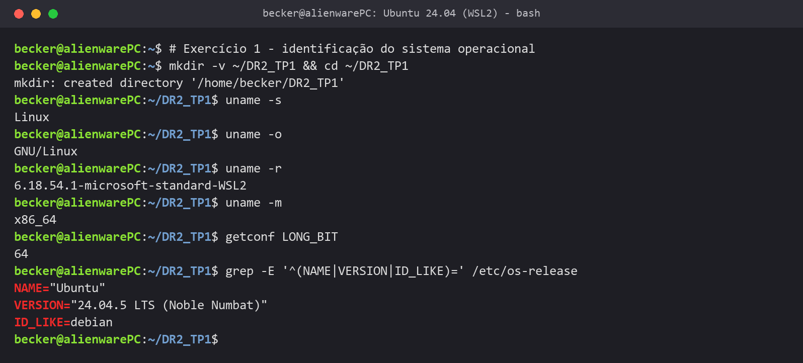

### Resposta

O `uname` lê os dados direto do kernel. O sistema é **Linux** (`-s`), do tipo **GNU/Linux** (`-o`),
um Unix-like. A versão é o kernel **6.18.54.1-microsoft-standard-WSL2** (`-r`) na distribuição
**Ubuntu 24.04.5 LTS**. A arquitetura é **x86_64**, ou seja, **64 bits**, como o `getconf LONG_BIT`
confirma. O Linux é central nos sistemas modernos: domina servidores, nuvem, supercomputadores e
embarcados, e é a base dos containers (Docker e Kubernetes usam namespaces e cgroups do kernel),
por ser estável, previsível, aberto e automatizável.

## Exercício 2: Distribuições Linux e contextos de uso

### Enunciado

> 1. Utilize comandos do terminal para identificar o nome e a versão da distribuição Linux instalada
> 2. Crie um arquivo de texto chamado distribuicoes.txt
> 3. Registre no arquivo o nome e a versão da distribuição identificada
> 4. Cite outras duas distribuições Linux conhecidas
> 5. Associe cada uma das distribuições citadas a um contexto típico de uso em sistemas computacionais, como desenvolvimento, servidores ou containers

### Teoria

As distribuições usam o mesmo kernel e diferem na política de atualização, no gerenciador de
pacotes e no público-alvo; por isso cada uma se encaixa melhor num contexto.

### Comandos e execução

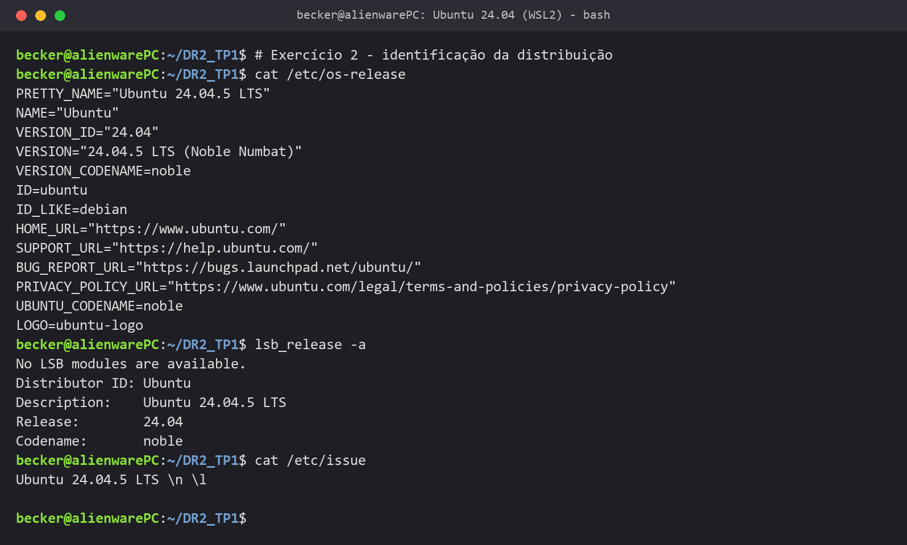

### Resposta

As três fontes confirmam o **Ubuntu 24.04.5 LTS (Noble Numbat)**, da família Debian, com pacotes
`.deb` e APT. Outras duas distribuições: o **Debian** (stable), típico de **servidores**, pelo ciclo
conservador e pelos pacotes muito testados, e o **Alpine Linux**, típico de **containers**, pela
imagem de poucos megabytes e pela menor superfície de ataque. O Ubuntu atende bem ao desenvolvimento.

## Exercício 3: Comandos básicos

### Enunciado

> 1. Abra um emulador de terminal e execute, em sequência, os comandos date, cal, df, free e exit
> 2. Registre a saída de cada comando em um arquivo chamado comandos_basicos.txt
> 3. Indique no arquivo quais comandos fornecem informações sobre armazenamento e memória

### Teoria

São comandos de consulta, com saída em texto, que servem tanto para leitura quanto para scripts. O
`df` trata do espaço em disco, o `free` da memória, e o `exit` encerra o shell.

### Comandos e execução

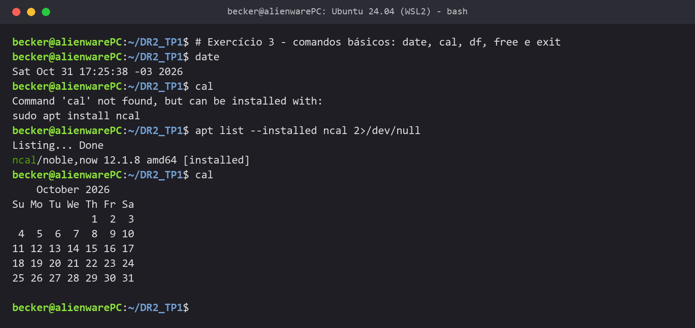

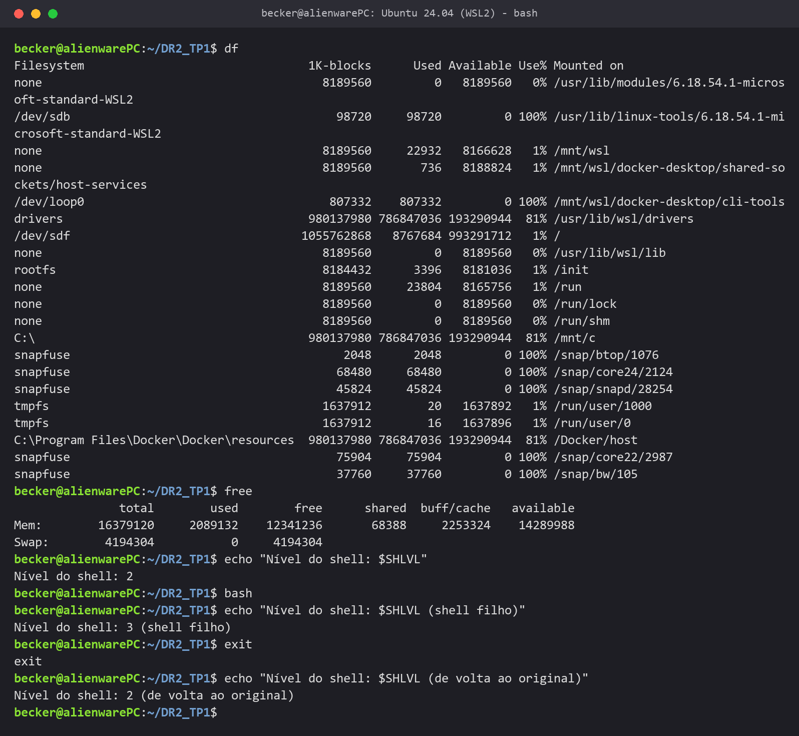

### Resposta

O **`df`** informa **armazenamento** e o **`free`**, **memória**. O `cal` não vinha na instalação
mínima do Ubuntu do WSL; o bash sugeriu o pacote, e eu instalei o `ncal` com o APT. Rodei o `exit`
num shell filho para não fechar o terminal: o `SHLVL` foi de 2 para 3 e voltou para 2. Os ~15 GiB
do `free` são o limite que o `.wslconfig` dá à máquina virtual, não a RAM física.

## Exercício 4: Recursos computacionais

### Enunciado

> 1. Utilize o terminal para obter informações sobre o processador do sistema
> 2. Utilize comandos para identificar dados de memória e armazenamento
> 3. Salve todas as saídas em um arquivo chamado recursos.txt
>
> Identifique claramente no arquivo quais informações correspondem a CPU, memória e disco

### Teoria

O kernel expõe o hardware em `/proc` e `/sys`, e o `lscpu`, o `free` e o `lsblk` formatam esses
dados, sem interface gráfica.

### Comandos e execução

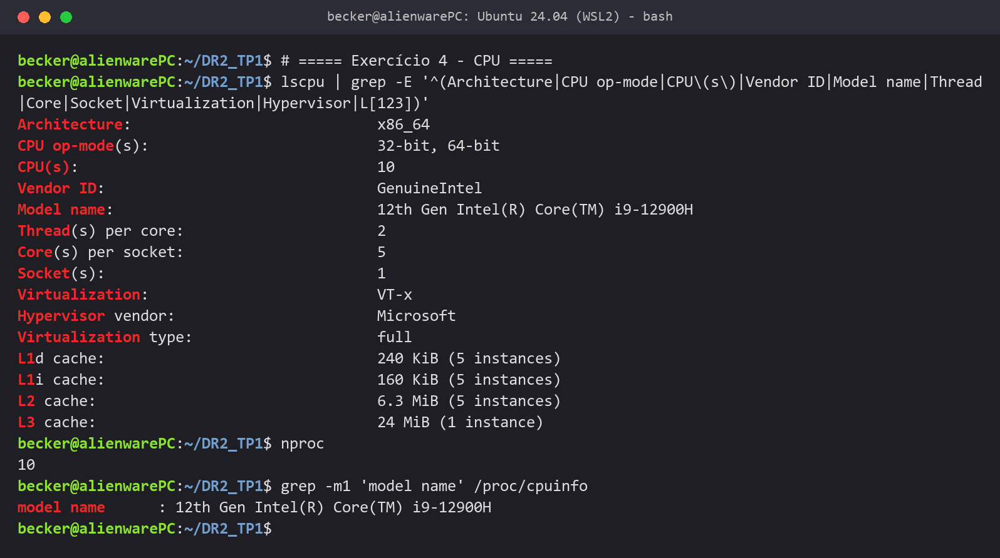

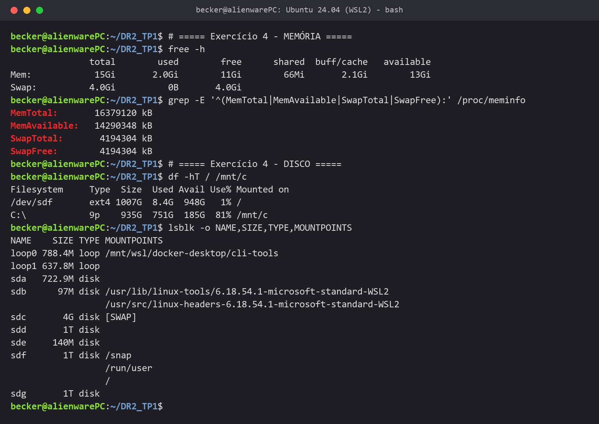

### Resposta

Separei os blocos com comentários no terminal e com os títulos CPU, MEMÓRIA e DISCO no arquivo:

- **CPU:** Intel Core i9-12900H, x86_64, com 10 CPUs lógicas visíveis;
- **memória:** 15 GiB de RAM e 4 GiB de swap;
- **disco:** raiz ext4 de 1007 GB e o drive C: em `/mnt/c`.

O processador tem 20 threads, mas o `.wslconfig` limita a máquina virtual a 10.

## Exercício 5: Navegação pelo sistema de arquivos

### Enunciado

> 1. Navegue até o diretório /var/log utilizando comandos do terminal
> 2. Confirme o diretório atual
> 3. Retorne ao diretório pessoal do usuário
> 4. Registre todos os comandos utilizados em um arquivo chamado navegacao.txt

### Teoria

O sistema de arquivos é uma árvore que começa em `/` e segue a hierarquia padrão (FHS): `/var/log`
guarda os registros do sistema e `/home`, os diretórios dos usuários.

### Comandos e execução

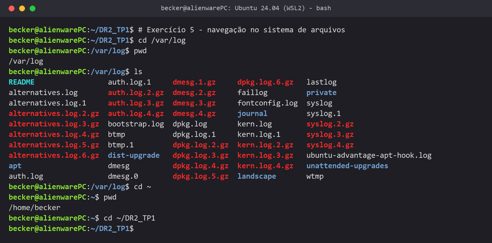

### Resposta

Fui até `/var/log` com caminho absoluto, que funciona de qualquer diretório, e o `pwd` confirmou o
diretório atual. Voltei ao diretório pessoal com `cd ~` (o `~` é o `$HOME`), confirmado pelo `pwd`
como `/home/becker`. O prompt também mostra o diretório a cada passo.

## Exercício 6: Visualização e tipos de arquivos

### Enunciado

> 1. Liste os arquivos do diretório pessoal utilizando ls
> 2. Escolha três arquivos distintos e utilize file para identificar seus tipos
> 3. Utilize less para visualizar o conteúdo de um arquivo de texto ou log
> 4. Registre os resultados em visualizacao.txt

### Teoria

O `file` identifica o tipo pelo conteúdo, não pela extensão. O `less` pagina o arquivo sem alterá-lo.

### Comandos e execução

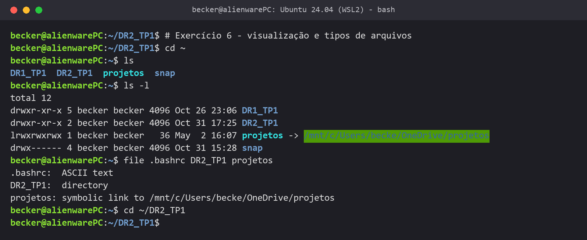

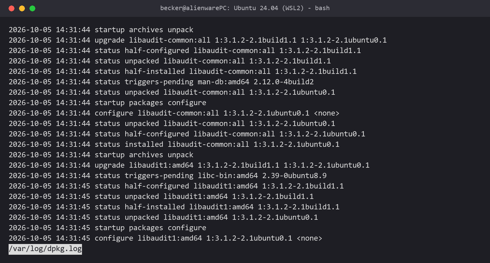

### Resposta

Escolhi três tipos distintos: o `.bashrc` é **texto**, o `DR2_TP1` é **diretório** e `projetos` é um
**link simbólico**. No `ls -l`, a primeira letra das permissões (`-`, `d`, `l`) também indica o
tipo. Abri o `dpkg.log` no `less`, a forma segura de ler um log: só lê, carrega por partes e permite
busca.

## Exercício 7: Manipulação de arquivos e diretórios

### Enunciado

> 1. Crie um diretório chamado tp_linux
> 2. Dentro dele, crie um arquivo chamado teste.txt
> 3. Copie esse arquivo para teste_backup.txt
> 4. Remova o arquivo teste.txt
> 5. Registre os comandos utilizados em manipulacao.txt

### Teoria

O `rm` não usa lixeira e não tem "desfazer", por isso as opções `-i` (confirmação) e `-v` (relato).

### Comandos e execução

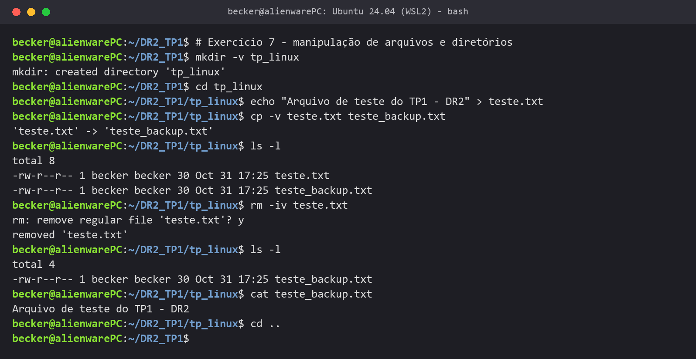

### Resposta

Criei o `teste.txt` já com conteúdo (`echo` com `>`), para poder verificar a cópia. Depois copiei
o arquivo para `teste_backup.txt` e removi o original com confirmação. O `cat` do backup mostrou o
texto original. Seguindo a ordem copiar, conferir e remover, o dado nunca fica sem cópia.

## Exercício 8: Comandos auxiliares e documentação

### Enunciado

> 1. Utilize type, which e help para investigar o comando ls
> 2. Utilize man, apropos, info e whatis para investigar o comando rm
> 3. Crie um alias simples para o comando ls
> 4. Registre todas as consultas e o alias criado em comandos_auxiliares.txt

### Teoria

Um nome no shell pode ser alias, comando interno (builtin) ou programa no `PATH`. O `type` e o
`which` dizem o que é, o `help` documenta os builtins, o `man` e o `info` são os manuais, e o
`whatis` e o `apropos` consultam o índice deles.

### Comandos e execução

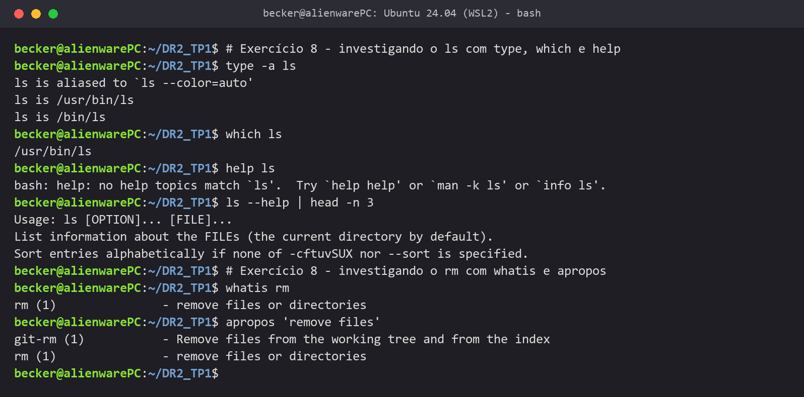

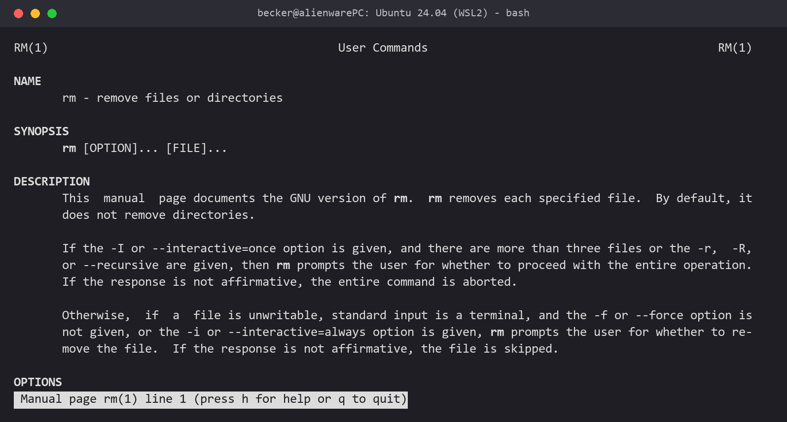

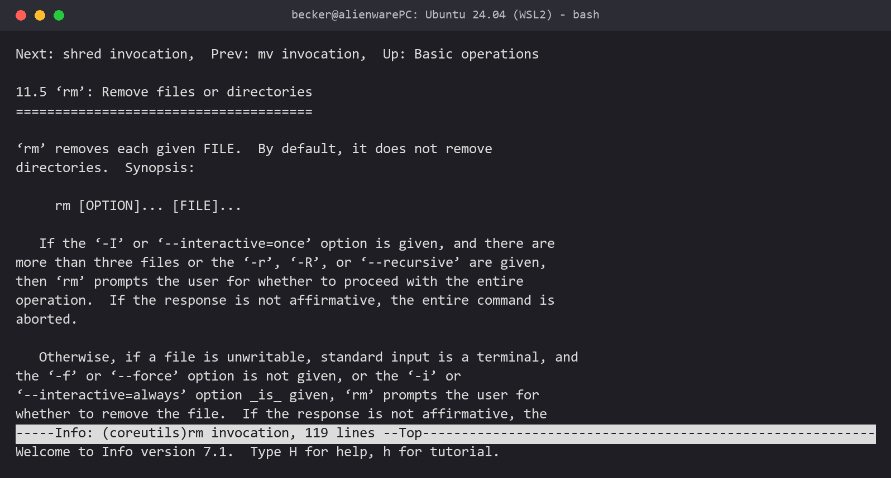

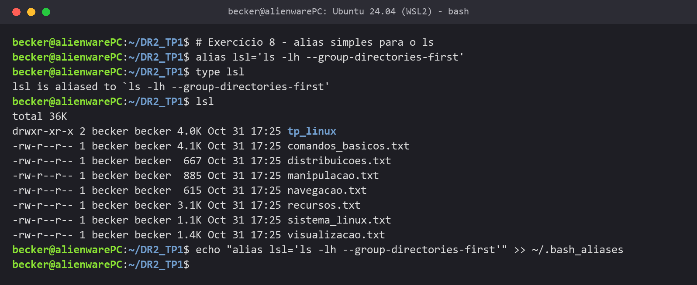

### Resposta

No `ls`, o `type -a` mostrou que no bash ele é um alias (`ls --color=auto`) para o executável
`/usr/bin/ls`, e o `which` mostrou só o executável. O `help ls` falhou porque o `help` documenta
apenas builtins; para o `ls`, existe o `ls --help`.

No `rm`, o `whatis` deu a descrição de uma linha e o `apropos` achou o comando pelo assunto. O `man`
e o `info` mostraram as opções `-i`, `-r` e `-f`. O alias `lsl` foi gravado em `~/.bash_aliases`
para valer em todo bash.

## Exercício 9: Pipeline e redirecionamento

### Enunciado

> 1. Liste os arquivos do diretório /etc
> 2. Utilize um pipeline para paginar a saída
> 3. Redirecione o resultado para um arquivo chamado pipeline.txt
> 4. Verifique o conteúdo utilizando less

### Teoria

O pipe `|` liga a saída de um comando à entrada do seguinte, e o `>` grava a saída num arquivo.

### Comandos e execução

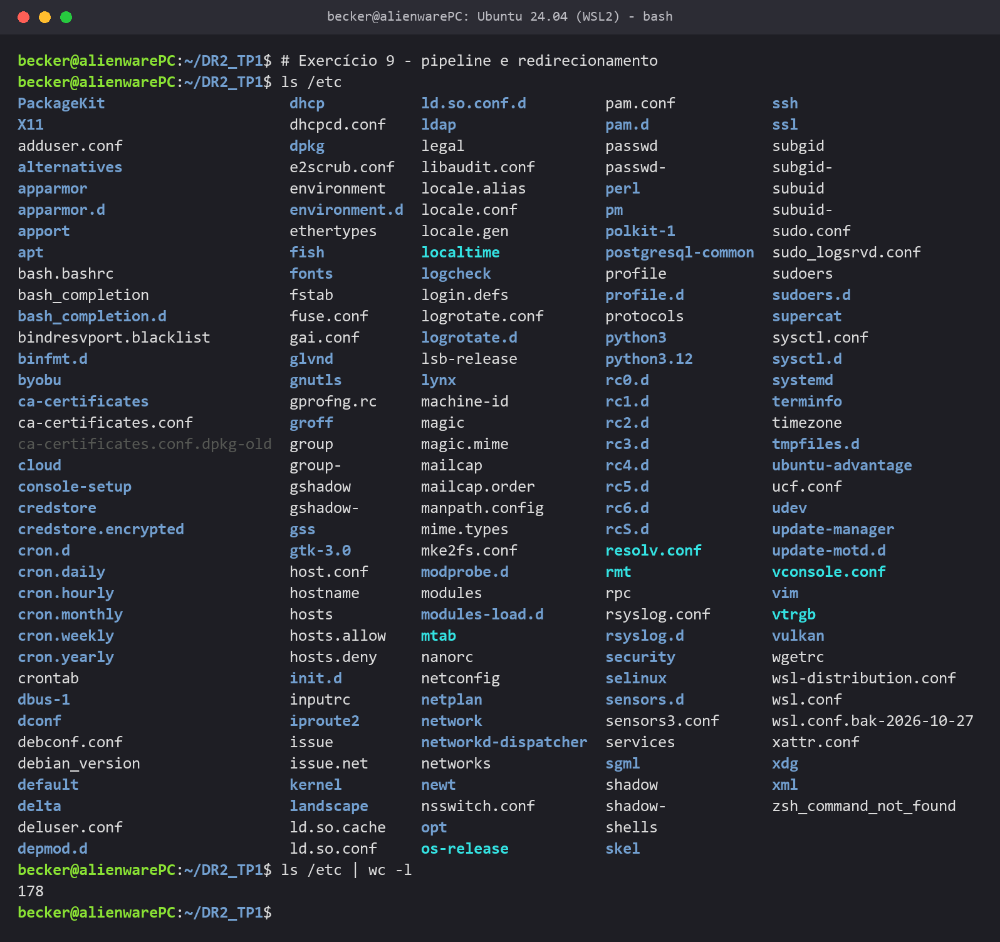

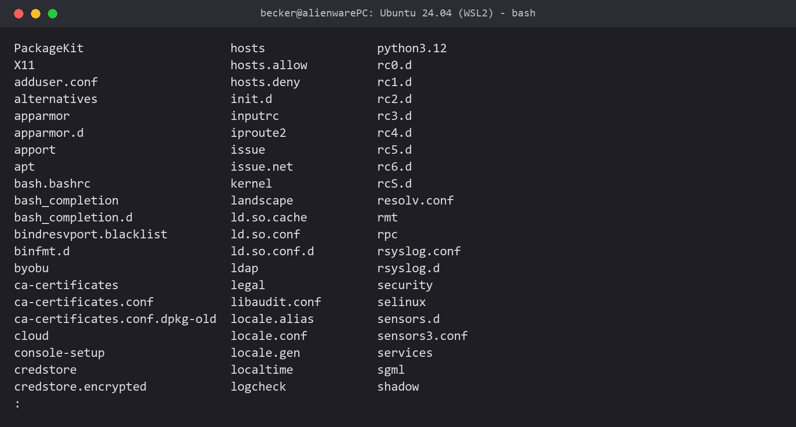

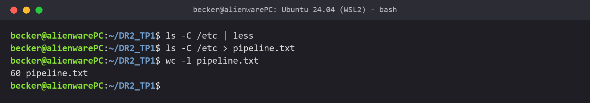

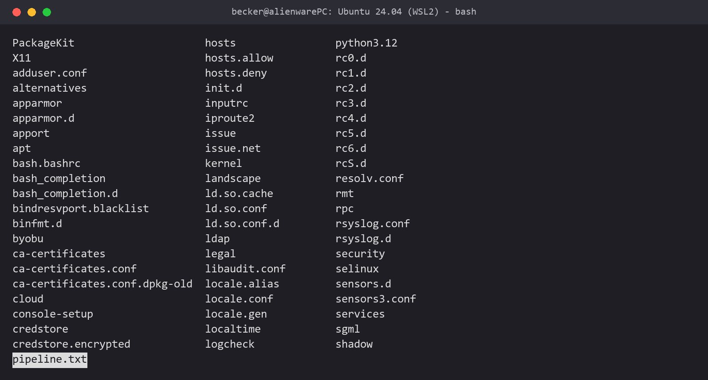

### Resposta

No pipeline `ls -C /etc | less`, a saída do `ls` virou a entrada do `less`. Com `>` gravei o mesmo
resultado em `pipeline.txt` e o verifiquei com `less`. Usei o `-C` para manter a listagem em
colunas também fora do terminal; sem ele, o `ls` gravaria um nome por linha.

## Exercício 10: Expansões do shell

### Enunciado

> 1. Utilize expansões de shell para listar arquivos com extensão .log
> 2. Utilize expansões para criar múltiplos arquivos simultaneamente
> 3. Registre os comandos e resultados em expansoes.txt

### Teoria

O shell reescreve o comando antes de executá-lo. Os curingas `*`, `?` e `[ ]` casam com arquivos
existentes, e as chaves `{a,b}` e `{1..3}` geram texto.

### Comandos e execução

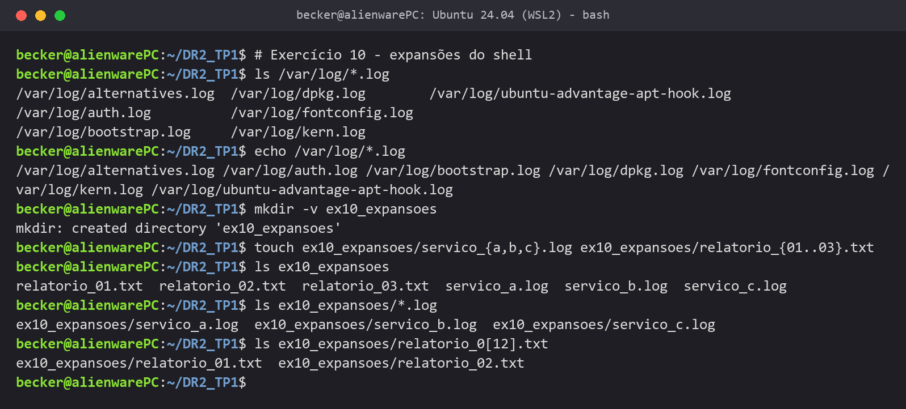

### Resposta

O `*.log` listou os logs, e o `echo` imprimiu a mesma lista, o que prova que quem expande é o shell.
Um único `touch` com `{a,b,c}` e `{01..03}` criou seis arquivos, e o `[12]` selecionou dois deles.

## Exercício 11: Aspas simples e duplas

### Enunciado

> 1. Crie um arquivo com espaço no nome utilizando aspas adequadas
> 2. Compare o comportamento de aspas simples e duplas com o comando echo
> 3. Registre comandos e observações em aspas.txt

### Teoria

O shell separa os argumentos nos espaços. As aspas duplas agrupam e mantêm a expansão de `$VAR` e
`$(...)`; as aspas simples tornam tudo literal.

### Comandos e execução

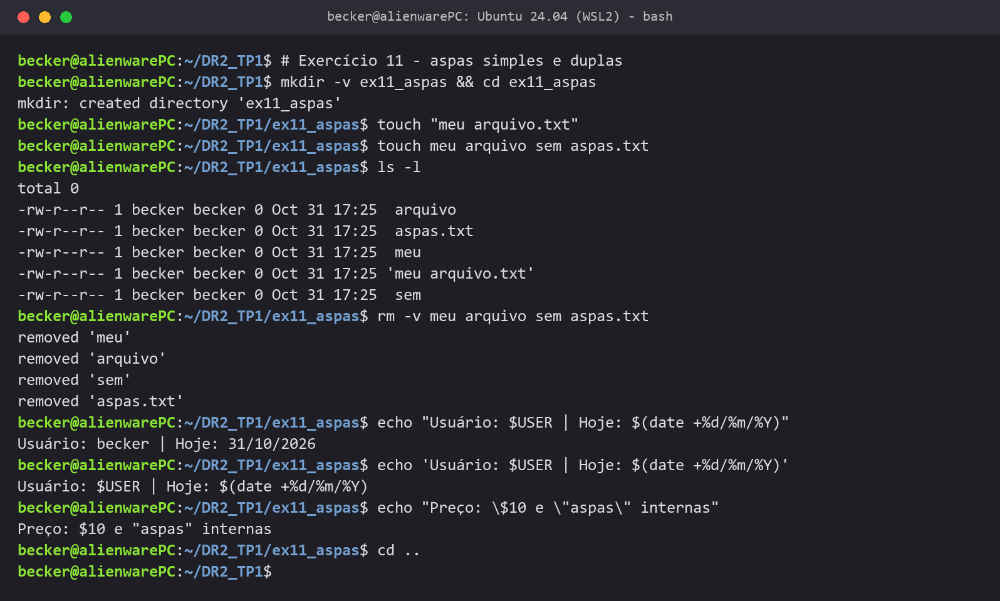

### Resposta

O `touch "meu arquivo.txt"` criou **um** arquivo; sem aspas, o mesmo comando criou **quatro**, que
depois removi. No `echo`, as aspas duplas expandiram `$USER` e `$(date)`, e as simples imprimiram o
texto literal. Uso aspas duplas para variáveis (`"$arquivo"`) e simples para textos que devem chegar
intactos.

## Exercício 12: Projeto final

### Enunciado

> 1. Crie um diretório chamado projeto_final
> 2. Utilize ls, file e less para inspecionar o arquivo
> 3. Utilize ao menos um comando auxiliar para investigar um dos comandos usados
> 4. Documente todo o processo em projeto_final.txt

### Teoria

O exercício junta os anteriores num fluxo real: criar, gerar, inspecionar e consultar a
documentação, registrando tudo.

### Comandos e execução

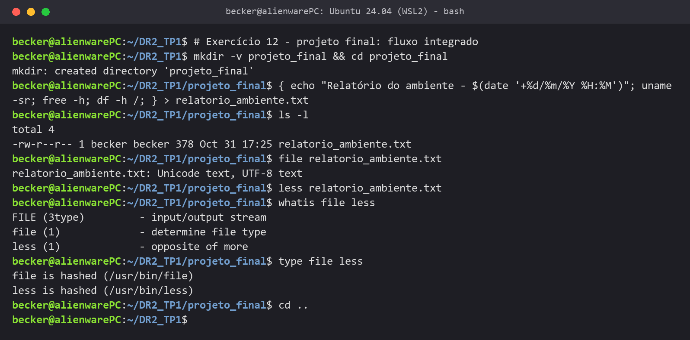

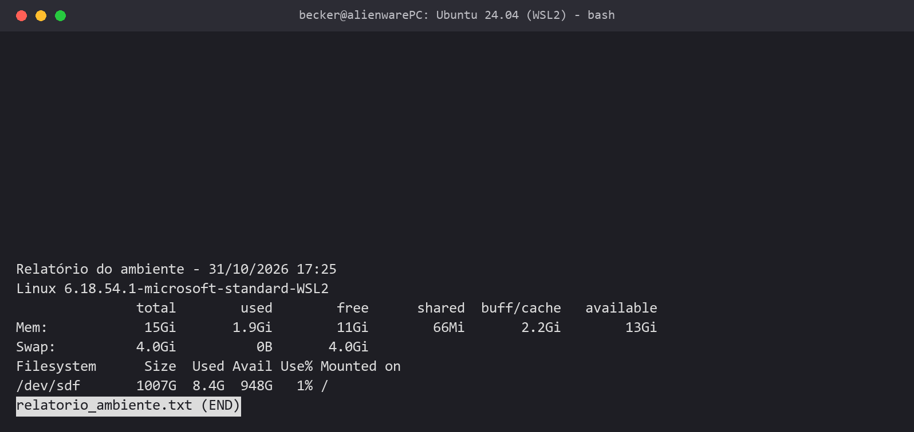

### Resposta

O enunciado não diz qual arquivo inspecionar, então criei um com conteúdo útil: um relatório do
ambiente gerado por `{ date; uname; free; df; } >`. O `ls -l` o confirmou, o `file` o identificou
como texto UTF-8 e o `less` mostrou o conteúdo. Para investigar os comandos usados, o `whatis` deu a
descrição do `file` e do `less`, e o `type` mostrou que os dois estão em `/usr/bin`.

## Atendimento à rubrica

| Critério | Onde está |
|---|---|
| Justifica a importância do Linux em sistemas computacionais modernos | Ex. 1 e 2 |
| Opera o terminal executando comandos básicos corretamente | Ex. 1 a 4 |
| Navega pelo sistema de arquivos pela linha de comando | Ex. 5, e o `cd` nos Ex. 6, 7, 11 e 12 |
| Visualiza e manipula arquivos e diretórios com precisão | Ex. 6, 7, 9, 10, 11 e 12 |
| Usa comandos auxiliares para documentação e suporte | Ex. 8 e 12 |
| Justifica decisões técnicas | Apresentação e resposta de cada exercício |
| Organiza e documenta os artefatos produzidos | `~/DR2_TP1`, com um `.txt` por exercício, e a Figura 23 |

## Anexo: arquivos de evidência

Conteúdo integral dos arquivos gravados em `~/DR2_TP1`, cuja organização a Figura 23 mostra.

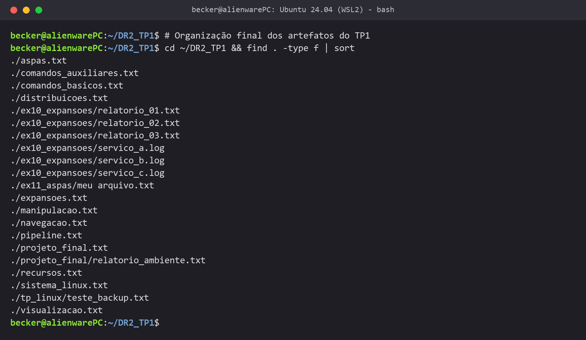

<!-- arquivo: sistema_linux.txt -->
<!-- arquivo: distribuicoes.txt -->
<!-- arquivo: comandos_basicos.txt -->
<!-- arquivo: recursos.txt -->
<!-- arquivo: navegacao.txt -->
<!-- arquivo: visualizacao.txt -->
<!-- arquivo: manipulacao.txt -->
<!-- arquivo: comandos_auxiliares.txt -->
<!-- arquivo: pipeline.txt -->
<!-- arquivo: expansoes.txt -->
<!-- arquivo: aspas.txt -->
<!-- arquivo: projeto_final.txt -->

<!-- so-github -->
| Arquivo | Exercício |
|---|---|
| [sistema_linux.txt](../evidencias/DR2_TP1/sistema_linux.txt) | 1 |
| [distribuicoes.txt](../evidencias/DR2_TP1/distribuicoes.txt) | 2 |
| [comandos_basicos.txt](../evidencias/DR2_TP1/comandos_basicos.txt) | 3 |
| [recursos.txt](../evidencias/DR2_TP1/recursos.txt) | 4 |
| [navegacao.txt](../evidencias/DR2_TP1/navegacao.txt) | 5 |
| [visualizacao.txt](../evidencias/DR2_TP1/visualizacao.txt) | 6 |
| [manipulacao.txt](../evidencias/DR2_TP1/manipulacao.txt) | 7 |
| [comandos_auxiliares.txt](../evidencias/DR2_TP1/comandos_auxiliares.txt) | 8 |
| [pipeline.txt](../evidencias/DR2_TP1/pipeline.txt) | 9 |
| [expansoes.txt](../evidencias/DR2_TP1/expansoes.txt) | 10 |
| [aspas.txt](../evidencias/DR2_TP1/aspas.txt) | 11 |
| [projeto_final.txt](../evidencias/DR2_TP1/projeto_final.txt) | 12 |
<!-- /so-github -->

## Referências

- SHOTTS, W. *The Linux Command Line*. 2. ed. San Francisco: No Starch Press, 2019. Caps. 1 a 7.
- TANENBAUM, A. S.; BOS, H. *Sistemas Operacionais Modernos*. 4. ed. São Paulo: Pearson, 2016. Cap. 1.
- Páginas de manual do Ubuntu 24.04 e manuais GNU Coreutils e GNU Bash (Free Software Foundation).
- THE LINUX FOUNDATION. *Filesystem Hierarchy Standard*, versão 3.0, 2015.
